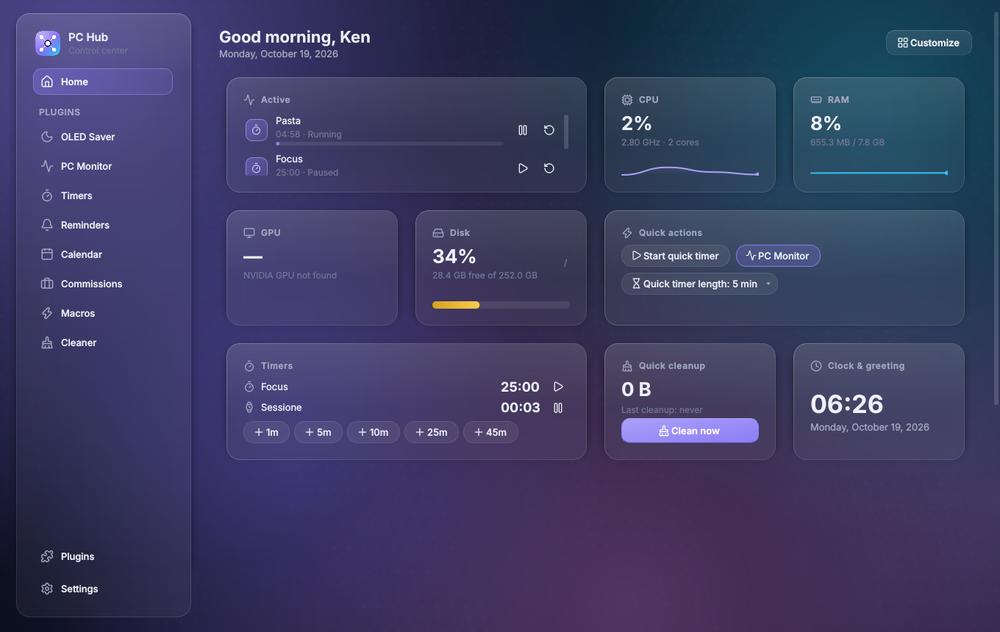
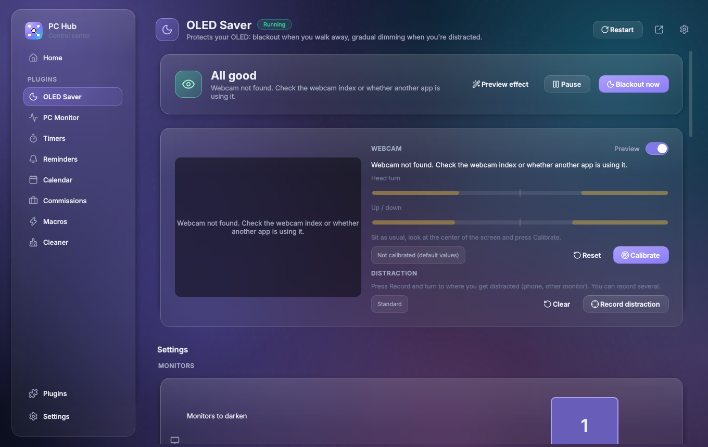
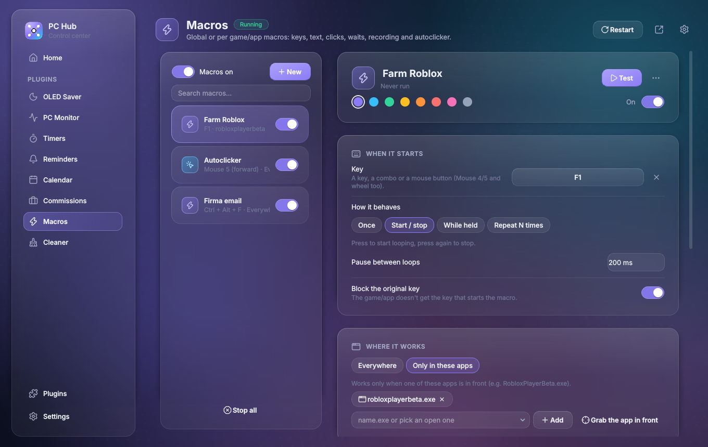
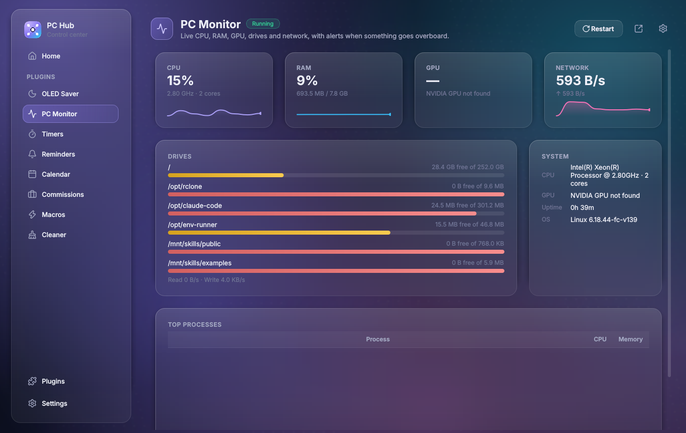
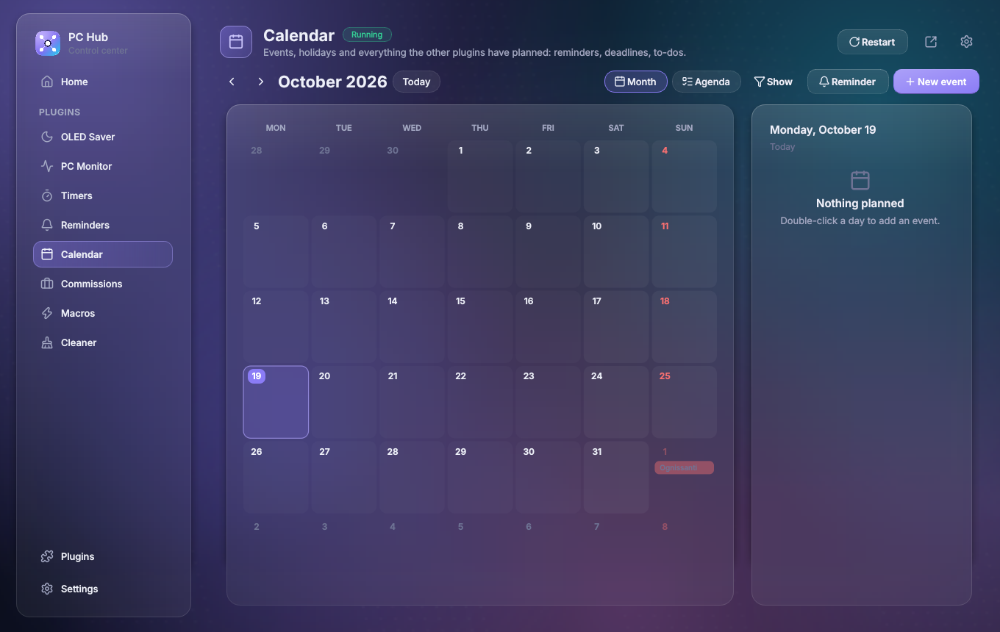
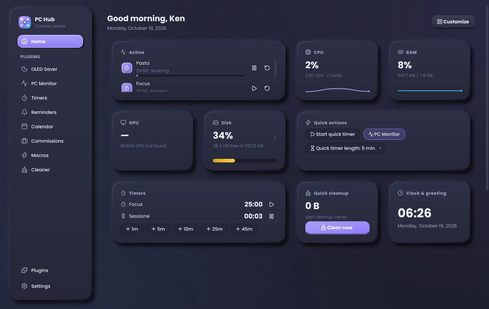
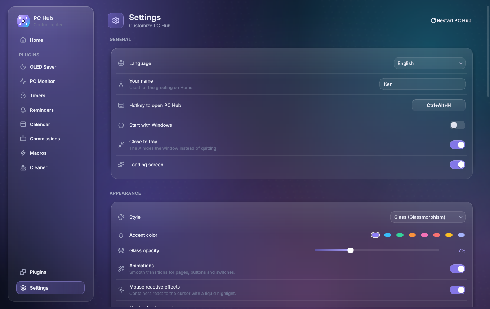

# PC Hub

**Your PC's control center.** A modular Windows app built on plugins: the OLED saver, the PC monitor, macros, reminders, calendar and timers each run in the background, and each one has its own page.

Made with Python + PySide6. It ships as a real installer, lives in the tray, uses global hotkeys and has two interchangeable looks: **glassmorphism** and **claymorphism**. The interface is in Italian and English.



---

## Features

### The app
- **Plugins as pages** in a sidebar you can reorder by dragging, with folders, sub-folders, custom names and icons.
- **Home you build yourself**: drag, resize and remove widgets from any plugin. An **Active** section shows what is running right now.
- **Every plugin has a gear** (top right) for its global settings:
  - on/off;
  - a hotkey to open it;
  - open in a **separate window**, which can stay always on top;
  - auto-restart;
  - uninstall.
- **Tray icon with pins**: pin any setting or action and it appears in the right-click menu.
- **Global hotkeys** with conflict checks.
- **Advanced Permissions** (administrator), start with Windows.
- **Notifications** bottom-right that go away on their own:
  - they slide in and out;
  - a line shows the time left;
  - hovering pauses them.
- **Robust**:
  - a broken plugin only breaks itself, with an error page and Disable/Delete buttons;
  - safe mode after a crash.
- **Automatic updates from GitHub** (this repository): small app updates, single-plugin updates, and automatic rollback if an update doesn't start.
- Every effect can be switched off: animations, mouse-reactive "liquid" containers, parallax.

### Built-in plugins
| Plugin | What it does |
|---|---|
| **OLED Saver** | Blacks out the screen when you walk away (webcam, YuNet face detection) and dims it gradually when you look away. Wakes up as soon as you look back. You choose the monitors, and you can calibrate both "looking at the screen" and your usual distractions. |
| **PC Monitor** | Live CPU, RAM, NVIDIA GPU, drives, network and heaviest processes, with alerts when a value stays high. |
| **Timers** | Several timers and stopwatches that keep counting even when the app is closed. Quick durations and hotkeys. |
| **Reminders** | Quick reminders typed in plain language ("tomorrow at 9 call Marco"), with repeats, snooze and alerts. |
| **Calendar** | Events with repeats and alerts, Italian holidays, plus everything from the other plugins (reminders, commission deadlines). |
| **Commissions** | Client jobs: board and list, deadlines, prices in €/Robux/$, hourly tracking, payments, yearly earnings, CSV/PDF export. |
| **Macros** | Global or per-game/app macros. Steps can be keys, text, clicks, mouse moves, scroll, waits and opening programs; you can also record them. The autoclicker is a macro type. Modes: once, start/stop, while held, repeat N times. |
| **Cleaner** | Temp files, caches, logs (Roblox/Studio too), Recycle Bin and your own folders with age/extension rules. It always shows what it will delete and asks "Are you sure?". |

<table>
<tr><td></td><td></td></tr>
<tr><td></td><td></td></tr>
<tr><td></td><td></td></tr>
</table>

---

## Install

**Easiest:** download `PCHub-Setup-x.y.z.exe` from [Releases](../../releases/latest) and run it.
Windows SmartScreen may warn you because the app isn't code-signed: click *More info → Run anyway*.

**From source**
1. Install **Python 3.11+** (tick *Add Python to PATH*).
2. Run `run_dev.bat` to start the app, or `build.bat` to build the exe and the installer (`dist\installer\`). `build.bat` installs Inno Setup with winget if it's missing.

Useful arguments: `--tray` (start hidden), `--open <pluginId>`, `--no-splash`, `--no-update-check`.

## Updates

PC Hub checks this repository's **Releases** at startup and every 6 hours. When it finds something newer, it downloads it, verifies it and asks you to **restart**. You can change this in *Settings › About*: check automatically, download automatically, check now.

| Release | Asset | What it updates |
|---|---|---|
| `v1.2.3` | `PCHub-update-1.2.3.zip` (+ `PCHub-Setup-1.2.3.exe`) | the whole app, without reinstalling |
| `plugin-<id>-<version>` | `PCHub-plugin-<id>-<version>.zip` | a single plugin (PC Hub keeps its version) |

The `BUILD_LEVEL` in `pchub/__init__.py` decides which way an app update goes:
- **Same `BUILD_LEVEL`:** the update is applied on the next start (`updater_boot.py`).
- **Higher `BUILD_LEVEL`** (new dependencies or a new exe): the app tells you to download the new installer.

If the first start after an update crashes, PC Hub goes back to the previous version by itself.

### Publishing (maintainers)
Push to `main`. [`.github/workflows/release.yml`](.github/workflows/release.yml) works out what changed
(`tools/release_plan.py`) and publishes it by itself:
- **`VERSION` went up** in `pchub/__init__.py`: the workflow publishes release `vX.Y.Z` with the update zip, then a
  Windows job builds and attaches `PCHub-Setup-X.Y.Z.exe`.
- **Only a plugin's `version` went up**: the workflow publishes release `plugin-<id>-<version>` with that plugin's zip.

Write the notes in `CHANGELOG.md` under `## vX.Y.Z` (or `## plugin-<id>-<version>`).

---

## Make a plugin

A plugin is a folder with a `plugin.py` defining a `PluginBase` subclass. The page **Plugins › New plugin** creates one from [`assets/plugin_template`](assets/plugin_template). You can also drop a `.zip` there, or put the folder in `%APPDATA%\PC Hub\plugins\`.

```python
from pchub.core.i18n import T
from pchub.core.plugin_api import PluginBase
from pchub.core.settings_schema import Section, Slider, Toggle


class HelloPlugin(PluginBase):
    pluginId = "hello"
    name = T("Ciao", "Hello")
    icon = "smile"
    settingsSchema = [
        Section(T("Generale", "General")),
        Toggle("loud", T("Ad alta voce", "Out loud"), False),
        Slider("times", T("Quante volte", "How many times"), 1, 10, 3),
    ]

    def start(self):            # engine: runs in the background from app start
        self.context.notify("Hello!", f"x{self.setting('times')}")

    def createPage(self):       # optional page (built once, at startup)
        return None


Plugin = HelloPlugin
```

Settings are declared, and the UI is generated for you: hotkeys, pins and translations all work. A plugin can also provide:
- Home widgets;
- tray entries;
- items in **Active**;
- calendar items;
- automation triggers and actions.

## Project layout

```
main.py                 entry point (runs updater_boot first)
updater_boot.py         applies/rolls back quick updates (frozen in the exe)
pchub/app.py            application: windows, tray, hotkeys, updates, error handling
pchub/core/             plugin manager, settings, storage, hotkeys, input hooks, updates, i18n
pchub/ui/               theme (glass/clay), widgets, pages, dialogs, alerts
pchub/plugins/          built-in plugins (one folder each)
assets/                 icons (Lucide), fonts, plugin template
build/                  PyInstaller spec, Inno Setup script
tools/                  update/release builders, screenshots, icon
tests/                  pytest suite (offscreen Qt)
```

Run the tests with `test.bat` or `pytest -q tests` (they run offscreen and don't need a webcam).

## Data

Everything lives in `%APPDATA%\PC Hub\`:
- settings (`app.json`, `plugin-settings\`);
- plugin data;
- user plugins;
- logs;
- downloaded updates.

Uninstalling keeps it. Settings can be exported and imported from the app.

---

Made by **Ken** · Icons by [Lucide](https://lucide.dev) (ISC) · Face detection model: [YuNet](https://github.com/opencv/opencv_zoo) (MIT)
